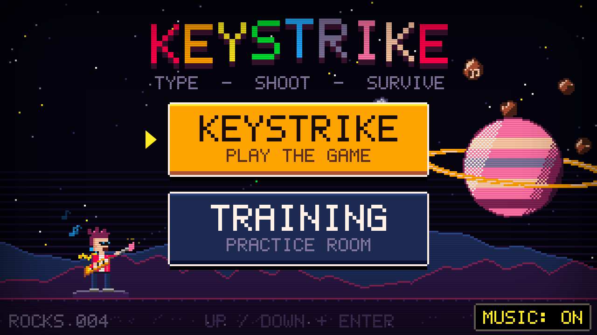
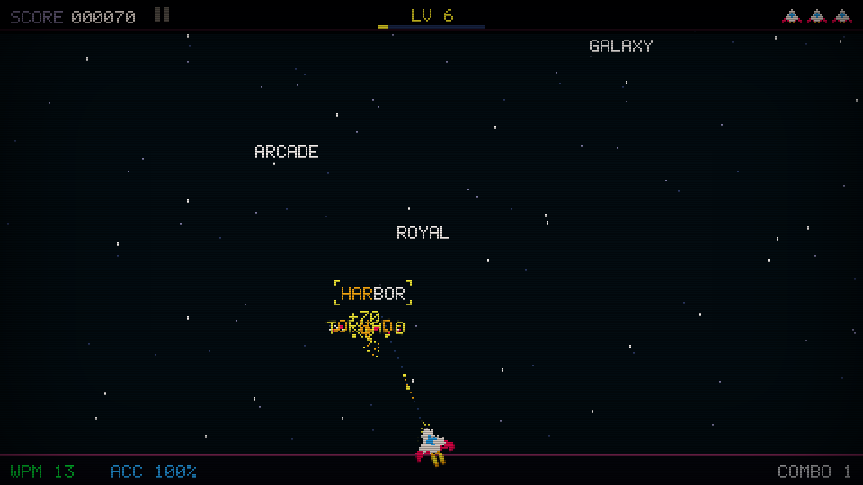
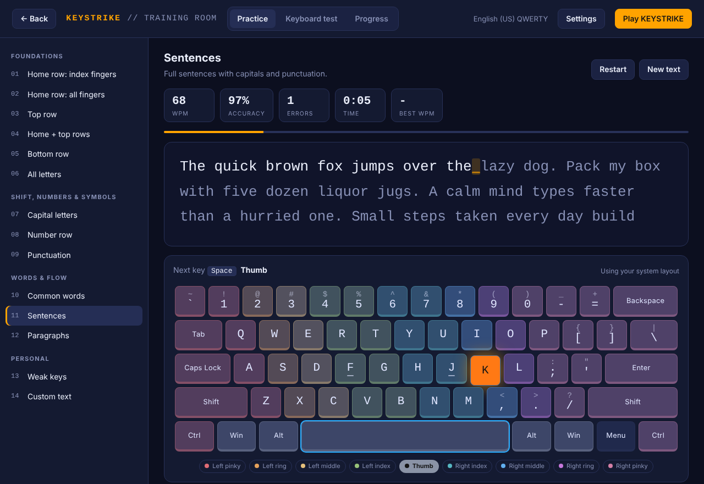

# KEYSTRIKE

I never properly learned to type. I've been using a keyboard for years, but always with a few fingers and a lot of looking down. So I made myself a small game to fix that, and figured it might help anyone else who's in the same spot.

It's a retro 8-bit typing game where words fall toward your ship and you shoot them down by typing. There's also a training room with practice sheets and an on-screen keyboard that lights up as you type. No accounts, no installs, nothing to set up. Just open it in a browser and start typing.

This is a fun side project, not a serious typing course. If it gets you a few words per minute faster, great.

## What's inside

There are three pages, and they all link to each other.

**Home page** (`index.html`)
A little animated scene: a guy playing a keyboard like a guitar, blasting asteroids with letters, plus an original chiptune I generated in code. From here you pick where to go.

**KEYSTRIKE, the game** (`keystrike.html`)

- Words drift down toward your ship. Type a word to lock on and fire.
- Finish a word and it blows apart in slow motion, which never gets old.
- It's endless. You start with tiny words like "go" and "sky", and by level 10 you're typing things like "constellation".
- Five clean words in a row bumps your score multiplier. One wrong key and it resets.
- You get 3 lives, plus a bonus life every 5th level.
- Top 10 high scores are saved, arcade style, with your name.
- It has its own looping 8-bit soundtrack, with separate on/off switches for music and sound effects.

**Training Room** (`keystrike-training.html`)

- 14 practice sheets, from home row basics through numbers, punctuation, sentences and full paragraphs.
- An on-screen keyboard that lights up every key you press. Each key is coloured by the finger that should press it, and the next key you need glows.
- Works with QWERTY (US and UK), Dvorak, Colemak, Colemak-DH, Workman, AZERTY and QWERTZ. There's even a mode that lets you practise Dvorak or Colemak without changing your computer's settings.
- A "Weak keys" sheet that builds itself from the keys you keep missing.
- A custom sheet where you can paste anything you want to practise.
- A keyboard test tab, handy for checking a new keyboard.
- A progress page with your speed over time and your best score on each lesson.
- No music in here, so you can focus.

## How to play

1. Download or clone this repo.
2. Keep `index.html`, `keystrike.html` and `keystrike-training.html` in the same folder.
3. Open `index.html` in Chrome, Edge or Firefox.
4. Click anywhere or press any key to start the music (browsers block sound until you do).
5. Pick KEYSTRIKE to play, or TRAINING to practise.

That's it. Everything runs locally in your browser and works offline.

### Controls

| Where | Keyboard | Mouse |
|---|---|---|
| Menus | Arrow keys + Enter | Hover and click |
| Game | Type the word on screen | Click a word to lock on, then type it |
| Pause | Esc | Click the pause icon next to the score |
| Training | Just type | Click the keys on the on-screen keyboard |
| Go back home | Esc on the game menu | The Back button |

### A few tips if you're just starting

- Rest your index fingers on **F** and **J**. They have little bumps so you can find them without looking.
- Start with the home row sheets in the Training Room before jumping into the game. It's boring for a day or two, then it clicks.
- Go for accuracy first. Speed shows up on its own.
- Try not to look at your hands. The on-screen keyboard is there so you don't have to.
- Ten minutes a day beats one long session a week.

## Where your scores are saved

High scores and practice progress are saved in your browser automatically. If you switch browsers or clear your browsing data, they'll be gone. To keep a backup:

- In the game, open **High Scores** and click **EXPORT**. You get a `.json` file you can load back later with **IMPORT**.
- In the Training Room, go to **Settings** and use **Export** / **Import**.

## How it's made

The whole thing is plain HTML, CSS and JavaScript. No frameworks, no libraries, no image or audio files.

- All the pixel art, including the font, the ship, the asteroids and the character, is drawn in code.
- The music and sound effects are generated live with the Web Audio API, so there's no copyrighted audio anywhere in here.

I built it with [Claude Code](https://claude.com/claude-code), going back and forth on ideas and testing each version as we went. It was a good way to turn a "what if" into something I actually use.

## Ideas for later

- More word packs (programming terms, Hindi in Latin script, movie titles)
- A boss wave every 10 levels
- Two-player mode on one keyboard
- Mobile support with an on-screen keyboard

If you try it and have ideas, open an issue. I'd like to hear them.

---

Made by Gyanendra Vyas, mostly to stop looking at my own hands while typing.
